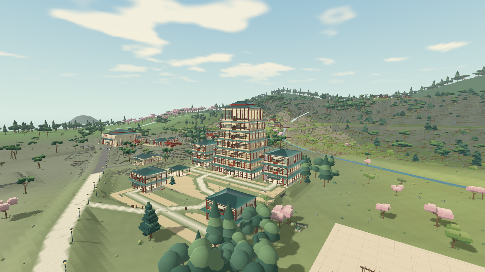
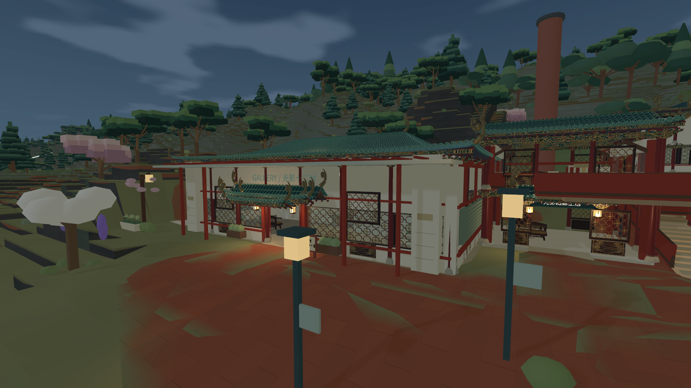

# Xiaoju Word — Traditional Architecture

可实际步行进入的中国传统建筑与山水园林世界，使用 Godot 4.7.2，面向 Windows 64 位离线游玩。仓库名沿用作者指定的 `xiaoju-word`；Traditional Architecture 意为“传统建筑”。

本项目从小鞠世界的皇家精工全图 0160b 独立发布，版本为 **0.16.0-open.1**。包含曲面铜绿瓦顶、朱漆柱、斗拱、花格、彩画梁、藻井、木作家具、庭院与昼夜灯光。东北角有浮空宫阙、飞鹤与环体。它是风格化建筑探索作品，未声称对故宫或颐和园进行考据复刻。

## 下载与游玩

从 [Windows 试玩版发布页](https://github.com/sanhyen/xiaoju-word-traditional-architecture/releases/tag/v0.16.0-open.1) 下载 `XiaojuWord-TraditionalArchitecture-0.16.0-open.1-windows-x86_64.zip`。完整解压后双击 `Start.cmd` 或 `XiaojuWorld.exe`。游玩无需安装 Godot 或 Python。默认使用 Mobile 渲染器和 Direct3D 12，需要兼容显卡。

发布页同时提供 `SHA256SUMS.txt`。源码可直接克隆本仓库，或下载 GitHub 自动生成的源码包。

## 世界内容

- 83 处建筑、58 处室外地点、130 处登记楼面、284 条地图目录。
- 保留 501 个原有静态互动 ID 和 63 项物品定义。
- 十五区景观、五条新增景观带、双岛、街巷、山林及七层城郭。
- 26 组精工构件用于建筑外观、廊道、室内及浮空景观。
- 保留地图、拍照、收藏、制作、自由布置、交通与旅行保存。

此版沿用 0150 的地形、道路、水系与碰撞。相对 0140 的有效干地面积约为 1.77745 倍，来自原有 2 米网格碰撞连通采样；本次没有重新测量，也不以浮空体或海面充数。

| 操作 | 按键 |
| --- | --- |
| 移动、跑步、跳跃 | WASD、Shift、空格 |
| 场馆服务、采集与交通 | E、F |
| 坐卧 | X；方向键起身 |
| 背包、布置、旋转 | B、G、R |
| 地图、小地图 | M、N |
| 斜俯视、观察模式、全图 | O、V、Home |
| 拍照、保存照片、保存进度 | P、F12、F5 |
| 昼夜天气 | F6 |

## 源码与资源

用 **Godot 4.7.2 标准版** 导入 `project.godot`，等待资源导入后运行主场景。已烘焙世界随源码提供。构建、资源再生成与导出见 [构建说明](docs/BUILD.md)。

代码和项目原创资源采用 [MIT](LICENSE)。字体、基础环境声和引擎依赖分别保留许可。部分原创装饰纹理由 AI 生成，提示词和哈希见 `data/craft160_art_sources.json`；其余精工几何由 Python 代码生成。全部公开资源登记于 `data/public_asset_manifest.json`。

本版照片、歌曲和 MV 展示位置使用明确标注的原创演示素材。私人素材、玩家作品、私人库和正常存档未随项目分发。详见 [素材说明](docs/MEDIA.md)。

公开版使用独立应用名与 `save/open_traditional_v1` 存档，不自动导入原项目或旧公开版旅行。可将有权使用的本地媒体导入程序旁的 `UserMedia`。

## 验证与限制

本版的工程、实际运行及发布回取检查见 [验证记录](docs/VALIDATION.md)。工程检查不代表作者已经认可所有建筑的美术质量，也不代表全图恒定帧率。原有墙体、部分楼梯、设备和植物仍保留较简化的造型，远处采用分层显示。

原项目：[sanhyen/xiaoju-world](https://github.com/sanhyen/xiaoju-world)。此仓库独立保留 0160b 的传统建筑方向。
